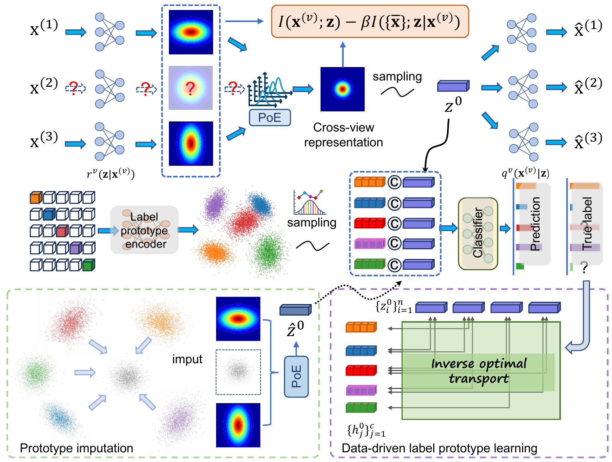

# SIPOT

### Semantic Invariant Representation Learning and Data-Driven Label Prototype Modeling for Incomplete Multi-View Multi-Label Classification

Official PyTorch implementation of **SIPOT**, published in **International Journal of Computer Vision (IJCV), 2026**.

**Chengliang Liu, Bo Li, Jie Wen, Yong Xu, Wenqi Ren, Xiaochun Cao, and Chao Huang**

[Paper (Springer)](https://link.springer.com/article/10.1007/s11263-026-03025-5) · [DOI](https://doi.org/10.1007/s11263-026-03025-5) · [Code](https://github.com/justsmart/SIPOT)

---

SIPOT addresses multi-label classification when both input views and label annotations are incomplete. It learns semantic invariant representations through an information bottleneck and models label prototypes through inverse optimal transport. The learned prototypes also provide semantic evidence for imputing missing views in latent space.

<p align="center">
  
</p>

<p align="center">
  <em><strong>SIPOT framework.</strong> Shared information learning compresses cross-view representations; inverse optimal transport aligns sample embeddings with label prototypes; attention-weighted prototype aggregation supplies missing-view representations before a second Product-of-Experts fusion.</em>
</p>

## Highlights

- **Semantic invariant representation learning:** an information bottleneck balances retention of useful information and removal of view-specific redundancy.
- **Data-driven label prototypes:** a bilevel formulation based on inverse optimal transport learns the correspondence between sample representations and label semantics.
- **Prototype-guided imputation:** attention over label prototypes supplies latent representations for missing views.
- **Incomplete supervision:** observation masks restrict supervised learning to available label annotations.
- **Five benchmarks:** experiments cover Corel5k, Pascal07, ESPGame, IAPRTC12, and MIRFLICKR under incomplete and complete settings.

## Results

Mean SIPOT results from Table 3 of the paper, under **50% available views and labels**, with a **70%/15%/15% train/validation/test split** and 10 repeated runs. All displayed metrics are better when larger. Standard deviations and comparison results are available in the paper.

| Dataset | AP | 1-HL | 1-RL | AUC | 1-OE | 1-Cov |
| --- | ---: | ---: | ---: | ---: | ---: | ---: |
| Corel5k | 0.430 | 0.988 | 0.911 | 0.913 | 0.518 | 0.789 |
| Pascal07 | 0.556 | 0.933 | 0.830 | 0.849 | 0.469 | 0.782 |
| ESPGame | 0.317 | 0.983 | 0.850 | 0.854 | 0.462 | 0.634 |
| IAPRTC12 | 0.345 | 0.980 | 0.888 | 0.889 | 0.476 | 0.683 |
| MIRFLICKR | 0.618 | 0.892 | 0.878 | 0.861 | 0.664 | 0.678 |

## Installation

From the repository root, install the dependencies:

```bash
python -m venv .venv
source .venv/bin/activate
pip install -r requirements.txt
```

A CUDA-enabled NVIDIA GPU is required by the training code. The paper's experiments use PyTorch 2.1.1 on an NVIDIA RTX 3090.

## Data preparation

Download the experimental datasets and their preprocessed incomplete-data splits from Google Drive:

> [Download MVMLC-DATA](https://drive.google.com/drive/folders/1ey17GpSJEYpYchY6Du_AOj5Yzi2Ml7JU?usp=drive_link)

Extract the dataset folders and place them under `data/` in the repository root:

```text
data/
├── corel5k/
├── pascal07/
├── espgame/
├── iaprtc12/
└── mirflickr/
```

## Training and evaluation

Run the default experiment:

```bash
python train_final.py
```

The script trains the model, selects the best epoch using validation AP, 1-RL, and AUC, and evaluates the selected model on the test split. Aggregated results are written to `final_records/`, which is empty before the first run.

## Repository structure

```text
SIPOT/
├── images/
│   └── framework.png   # Architecture figure from the paper
├── final_records/      # Empty output directory for experiment records
├── MLdataset.py        # MATLAB data loading, observation masks, and splits
├── model_VAE.py        # Variational encoders, decoders, and PoE fusion
├── model_imput.py      # Label prototypes, latent imputation, and classifiers
├── myloss.py           # Supervision and representation/prototype losses
├── evaluation.py       # Multi-label evaluation metrics
├── utils.py            # Logging and metric aggregation
├── train_final.py      # Sole training and evaluation entry point
├── requirements.txt    # Runtime dependencies
└── README.md
```

## Citation

If you use this code in your research, please cite the IJCV article:

```bibtex
@article{liu2026sipot,
  author  = {Chengliang Liu and Bo Li and Jie Wen and Yong Xu and Wenqi Ren and Xiaochun Cao and Chao Huang},
  title   = {Semantic Invariant Representation Learning and Data-Driven Label Prototype Modeling for Incomplete Multi-view Multi-label Classification},
  journal = {International Journal of Computer Vision},
  year    = {2026},
  volume  = {134},
  eid     = {427},
  doi     = {10.1007/s11263-026-03025-5}
}
```

This journal article extends the ICML 2024 SIP method with inverse optimal transport-based prototype learning and prototype-guided missing-view imputation.
